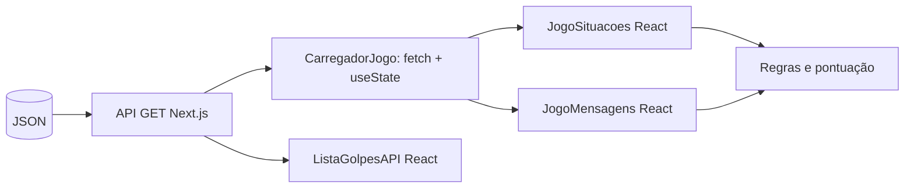

# FraudShield — Projeto 2 (Next.js + React)

Projeto educacional de prevenção a golpes digitais, principalmente para pessoas idosas. Esta é a **única aplicação mantida no repositório**. Não existe mais uma versão separada em HTML/CSS/JavaScript.

## Como executar

Pré-requisito: Node.js 20.9 ou mais recente.

```bash
cd "Projeto 2"
npm install
npm run dev
```

Acesse `http://localhost:3000`.

Para conferir a aplicação antes da entrega:

```bash
npm test
npm run build
npm run test:smoke
npm run start
```

## Páginas

O App Router do Next.js implementa as oito páginas `/`, `/sobre`, `/golpes`, `/dicas`, `/quiz`, `/quiz1`, `/quiz2`, `/contato` e a rota dinâmica `/golpes/[id]` (retorna 404 quando o ID não existe).

## O JSON e os jogos (Check-in 3 / check-in final)

| Fonte única de dados | API GET no Next.js | Quem usa |
|---|---|---|
| `data/situacoes.json` — 62 situações | `/api/situacoes` | `JogoSituacoes.jsx` (Fase 1) |
| `data/mensagens.json` — 55 mensagens | `/api/mensagens` | `JogoMensagens.jsx` (Fase 2) |
| `data/golpes.json` — exemplos e orientações | `/api/golpes` | `ListaGolpesAPI.jsx` e `/golpes/[id]` |

**Fluxo real:** arquivos `.json` → arquivos `app/api/*/route.js` com `Response.json()` → requisição HTTP `fetch()` em `useEffect()` → `useState()` do componente React `CarregadorJogo.jsx` → `JogoSituacoes.jsx` ou `JogoMensagens.jsx` → interface e pontuação.

A primeira fase sorteia quatro situações e permite selecionar ou arrastar um cartão até **Golpe** ou **Seguro**. A segunda sorteia quatro mensagens: o jogador marca palavras suspeitas, verifica as escolhas e recebe correção. Mensagens sem sinais são válidas, com nenhum botão marcado. Cada resposta totalmente correta vale 10 pontos.

O carregador mostra **Carregando...**, valida a resposta HTTP e o formato da lista e, caso algo falhe, mostra **Tentar novamente**. Não existe mais `LegacyScripts`, carregamento dinâmico de `<script>`, dados injetados em `window`, ou pasta `public/js`. As perguntas e os sinais **não estão escritos em JavaScript**: vêm das APIs JSON. A interface e as regras são componentes React e módulos auxiliares normais.

Os pontos, recordes de rodada e conclusão ficam no `localStorage` do navegador (sem cadastro e sem banco de dados). O botão **Zerar placar** apaga também a marcação de conclusão das fases. O formulário da página Contato é uma demonstração local e **não envia dados**.

### Explicação simples para o professor

1. Abra `/api/situacoes` e `/api/mensagens` para mostrar as respostas JSON.
2. Abra `/quiz1` ou `/quiz2`. O React executa `fetch("/api/situacoes")` ou `fetch("/api/mensagens")` quando o componente é montado.
3. O Next.js lê o arquivo JSON no servidor e devolve os dados como HTTP 200 `application/json`. O React recebe a lista, guarda em estado e renderiza os cartões ou palavras.
4. Abra `/golpes` para mostrar `/api/golpes` e clique em um cartão para demonstrar `/golpes/1` etc., uma rota dinâmica baseada em `id`.

**Importante:** os JSONs são importados na compilação do servidor. Excluir ou mudar um arquivo depois do build não atualiza automaticamente a aplicação em produção; é preciso restaurar o arquivo e fazer novo build/deploy. O jogo que já carregou os dados pode continuar usando o estado da sessão até recarregar, mas não deve ser usado sem os arquivos-fonte.

## Organização

```text
Projeto 2/
├── app/                oito páginas, rota dinâmica e três endpoints GET
├── components/         componentes React, jogos e carregador da API
├── data/               mensagens.json, situacoes.json, golpes.json
├── lib/                regras de jogo e pontuação (sem DOM legado)
├── public/img/         logo e favicon
├── styles/             CSS global e estilos específicos das páginas
├── scripts/            testes automatizados e smoke HTTP
├── docs/               diagrama de componentes
├── next.config.mjs
└── package.json
```

Não há HTML estático nem JavaScript executado como script independente. JSX, os route handlers `.js` e módulos `.mjs` são partes necessárias de Next.js/React. Os arquivos CSS são apenas de apresentação, compartilhados via `globals.css` para evitar duplicação.

### Diagrama de componentes



O diagrama completo editável está em `docs/diagrama-componentes.mmd`.

## Testes automatizados

- `npm test`: esquema/quantidades/consistência do JSON; rotas API; regras de classificação de situações e sinais; pontuação, recorde, conclusão e limpeza; dependências entre React e APIs; ausência de código legado.
- `npm run build`: compilação do Next.js com todas as rotas.
- `npm run test:smoke`: inicia Next.js de produção, verifica oito páginas, imagens, respostas de três APIs comparadas aos três arquivos JSON, detalhes dinâmicos e 404 para IDs inexistentes e recursos legados.

Os testes de lógica e HTTP são automatizados e reprodutíveis; não são uma garantia de cobertura completa de interações de navegador.

## AWS Amplify

O arquivo `amplify.yml` da raiz define `appRoot: Projeto 2`, instala dependências, testa e compila com `next build`, publicando `.next` com SSR. No Amplify, selecione a pasta `Projeto 2` como raiz do monorepo.

## Apoio de IA

O ChatGPT (OpenAI) auxiliou na organização, migração, implementação, revisão e testes. As decisões e o funcionamento dos componentes devem ser compreendidos e apresentados pelo estudante.
