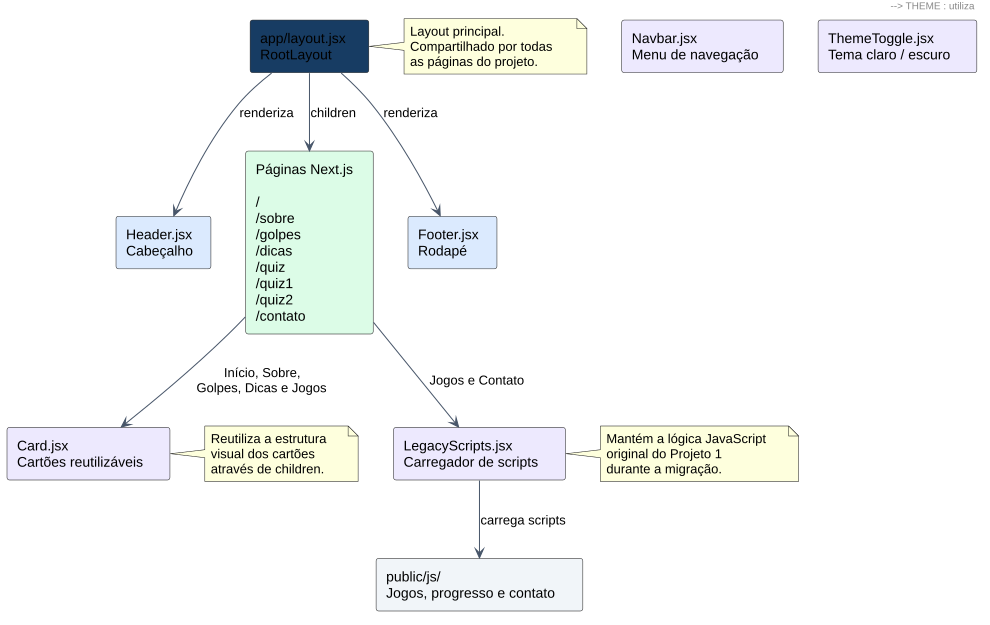

<p align="center">
  
</p>

<h1 align="center">FraudShield</h1>


<p align="center">
  <strong>Integrante:</strong> Murilo Lobato — <strong>RA:</strong> 10752958
</p>

---

<p align="center">
  
  
</p>

## Ideação

Os golpes agora usam voz clonada, imagens falsas e mensagens feitas por IA, e as pessoas idosas são as mais atingidas. O FraudShield ensina a se proteger na prática, com conteúdo simples e dois jogos: identificar se uma situação é golpe e achar os sinais de alerta em mensagens suspeitas.

## Caráter extensionista

- Público real, não técnico — foco em pessoas idosas, alvo comum de golpe.
- Gratuito, roda offline/local, pode ser usado em oficina, telecentro, biblioteca.
- Ensina atitude prática (confirmar por outro canal, não repassar senha), não teoria.

## Como rodar no Next.js

Pré-requisito: Node.js 20.9 ou superior. A partir da raiz do repositório:

```bash
cd "Projeto 2"
```

```bash
npm install
npm run dev
```

Abra http://localhost:3000. **Todas as oito páginas** são renderizadas por rotas Next.js:
`/`, `/sobre`, `/golpes`, `/dicas`, `/quiz`, `/quiz1`, `/quiz2` e `/contato`.

Para testar a compilação de produção:

```bash
npm run build
npm run test:smoke
npm run start
```


## Os jogos

| | Jogo | Como funciona |
|---|---|---|
| **Fase 1** | Golpe ou seguro? | Toque numa situação e escolha a caixa certa (ou arraste o cartão). |
| **Fase 2** | Encontre os sinais | Toque nas palavras suspeitas de uma mensagem e clique em verificar. |

Cada acerto vale 10 pontos. O placar e o recorde ficam salvos no navegador.

## Wireframes

| Início | Sobre | Golpes |
|---|---|---|
|  |  |  |

| Dicas | Quadro | Quiz |
|---|---|---|
|  |  |  |

| Quiz 1 | Quiz 2 | Contato |
|---|---|---|
|  |  |  |

Fixou cedo: cabeçalho + menu, hero texto/imagem, 4 cartões de destaque, rodapé simples.

## Estrutura do Projeto 2

```text
Projeto 2/
├── app/                  oito rotas (/, /sobre, /golpes, /dicas,
│                         /quiz, /quiz1, /quiz2, /contato)
│   └── layout.jsx        estrutura compartilhada das oito páginas
├── components/
│   ├── Header.jsx        logotipo, menu e botão de tema
│   ├── Navbar.jsx        menu com rota ativa
│   ├── Footer.jsx        rodapé comum às páginas
│   ├── Card.jsx          cartão de conteúdo reutilizável
│   ├── ThemeToggle.jsx   alternância claro/escuro
│   └── LegacyScripts.jsx carregamento da lógica original dos jogos
├── styles/
│   ├── globals.css       estilos gerais
│   └── pages/            sete CSSs de páginas
├── public/
│   ├── img/              logotipo e favicon
│   └── js/               scripts existentes dos jogos e contato
├── scripts/              teste de rotas e estrutura
└── package.json
```

A versão original completa está em [Projeto 1](../Projeto%201/README.md), separada desta aplicação Next.js.

### Adaptação de HTML e CSS

As oito páginas originais foram adaptadas de HTML para JSX; os links agora apontam para as rotas Next.js. Os estilos globais e os sete CSSs específicos foram preservados, sem Tailwind ou CSS-in-JS.

### Componentes de interface

`app/layout.jsx` utiliza `Header` e `Footer` uma única vez para todas as páginas. `Header` reutiliza `Navbar` (mostra qual seção está ativa) e `ThemeToggle` (controla o tema com `useState` e `useEffect`). O componente `Card` aparece nas listas de Início, Sobre, Golpes, Dicas e Jogos; recebe o conteúdo por `children` e mantém a classe CSS original `cartao`.

### Diagrama de ligação entre os componentes

O diagrama registra as relações **confirmadas nos arquivos JSX** e diferencia os componentes React dos scripts legados. Cada seta indica quem renderiza ou usa o item ligado.



[**Abrir SVG em tamanho original**](docs/diagrama-componentes-plantuml.svg)

**Relações principais:** o `RootLayout` inclui `Header`, as oito páginas e `Footer`; `Header` inclui `Navbar` e `ThemeToggle`; cinco páginas usam `Card`; Jogos e Contato usam `LegacyScripts`, responsável por carregar os arquivos de `public/js/`.

O código do diagrama também está salvo em [`docs/diagrama-componentes.mmd`](docs/diagrama-componentes.mmd) para edição e reutilização no envio ao professor.

### Estado atual dos jogos

Os jogos e o formulário usam temporariamente a lógica JavaScript original, carregada por `LegacyScripts` depois que a página é renderizada. A migração da lógica dos jogos para hooks React, a API local e as rotas dinâmicas continuam fora desta etapa.

### Transparência sobre IA

O ChatGPT (OpenAI) foi utilizado como apoio para adaptar o HTML/CSS, organizar os arquivos em Projeto 1/Projeto 2, extrair e revisar componentes React, configurar as verificações e documentar o código. Os trechos devem ser estudados e explicados pelo integrante na apresentação; o uso de IA não substitui o domínio da implementação.


## Tutorial do código

**Next.js e JSX** — as oito rotas usam `app/`. O layout raiz carrega `styles/globals.css`, `Header` e `Footer`; as outras páginas importam seus estilos específicos. `LegacyScripts` carrega os scripts dependentes em sequência após a montagem.

**HTML original, arquivado no Projeto 1** — sem `<div>`; layout feito com `flex`/`grid` direto em tags semânticas (`section`, `ul`, `article`); `details`/`summary` nos golpes expansíveis; `progress` na barra do quiz.

**CSS** — cada página tem o seu arquivo, com o visual comum (cores, cabeçalho, botões, cartões) e só as partes que ela usa: as regras dos jogos ficam só em `quiz1.css` e `quiz2.css`, por exemplo. As cores saem da logo (azul-marinho + ciano) e ficam em `:root` e `:root[data-tema="escuro"]`; o resto usa `var(--cor)`.

**Visual 8-bit** — fonte pixelada "Press Start 2P" nos títulos, botões e placares (carregada do Google Fonts; sem internet cai para monoespaçada), contornos de 4px com cantos "comidos" feitos com `box-shadow` (variável `--caixa`), botões que afundam no clique, grade quadriculada no fundo, cursor piscando nos títulos e barra de progresso em blocos. A logo de 48px é ampliada com `image-rendering: pixelated`. O texto corrido continua em fonte comum de 18px, pensando na leitura do público idoso; as animações param com `prefers-reduced-motion`.

**`ThemeToggle.jsx`** — lê a preferência salva (ou a do sistema), aplica `data-tema` e permite alterar o tema por meio de um estado React.

**`progresso.js`** — só lida com números no `localStorage`: pontos, recorde, conclusão, e `sortearRodada()` embaralha e corta a lista de situações/mensagens.

**`feedback.js`** — `criarElemento()`, `mostrarResultado()` (escreve em `role="status"`) e `destacarResultado()` (move o foco), usados pelos dois jogos.

**`js/dados/*.js`** — só listas de objetos (texto + resposta/sinais). Adicionar conteúdo = adicionar um item na lista, nada mais.

**`quiz1.js`** — cartões sorteados de `bancoSituacoes`; cada um é arrastável e também um `<button>` (acessível por teclado); `classificar()` roda no clique ou no `drop`; some pontos e marca conclusão ao fim da rodada.

**`quiz2.js`** — mensagem quebrada em palavras clicáveis; `normalizar()` tira acento/maiúscula/pontuação pra comparar; `verificar()` marca cada palavra como certa (✓), errada (✕) ou perdida (!).

**`quiz.js`** — só lê o que `progresso.js` salvou e atualiza a barra; reage a `pageshow` e ao evento `storage` (sincroniza entre abas).

**`contato.js`** — não envia nada; monta o texto e copia com `navigator.clipboard`, com fallback de seleção manual se a API falhar.

## Acessibilidade

`aria-pressed`, `aria-current`, `aria-label`, `role="status"`; foco movido após cada resultado; jogável por mouse, toque, teclado e arrastar; progresso salvo local, sem servidor.

## Aprendizados

- Separar a estrutura visual repetida em componentes torna o código menor e facilita futuras alterações.
- Com `children`, um mesmo `Card` pode mostrar conteúdo diferente, sem duplicar a estrutura HTML.
- A navegação destaca a seção ativa a partir da URL usando `usePathname`.
- O site mantém foco em acessibilidade e linguagem simples para o público idoso.
- Os scripts dos jogos foram preservados nesta etapa para evitar antecipar a migração completa da lógica.


## Hospedagem na AWS Amplify (Check-in 2)

A aplicação usa exportação estática do Next.js por meio de `next.config.mjs` (`output: "export"` e `trailingSlash: true`). A compilação produz `Projeto 2/out/`, contendo o HTML das oito rotas, CSS, JavaScript, fontes e imagens necessários para disponibilizar o site sem servidor Node.js.

O arquivo `amplify.yml`, na **raiz do repositório**, configura o monorepo com `appRoot: 'Projeto 2'`, executa `npm install`, `npm run build` e `npm run test:smoke`, e publica `out/`. No assistente AWS Amplify, selecione a branch `main`, diretório raiz **Projeto 2** e diretório de saída **out**. Não use a URL do GitHub nem o caminho codificado `Projeto%202` nesses campos.

Comandos locais, executados em `Projeto 2/`:

```bash
npm install
npm run build
npm run test:smoke
npm run start
```

Após executar `npm run start`, o site exportado pode ser acessado em `http://localhost:3000`. Para desenvolvimento, continue utilizando `npm run dev`.

**Limite desta publicação:** o site funciona com arquivos estáticos e scripts executados no navegador. Uma API interna de Next.js ou renderização no servidor, previstas para etapas futuras, exigirá remover `output: "export"` e reconfigurar a hospedagem.
