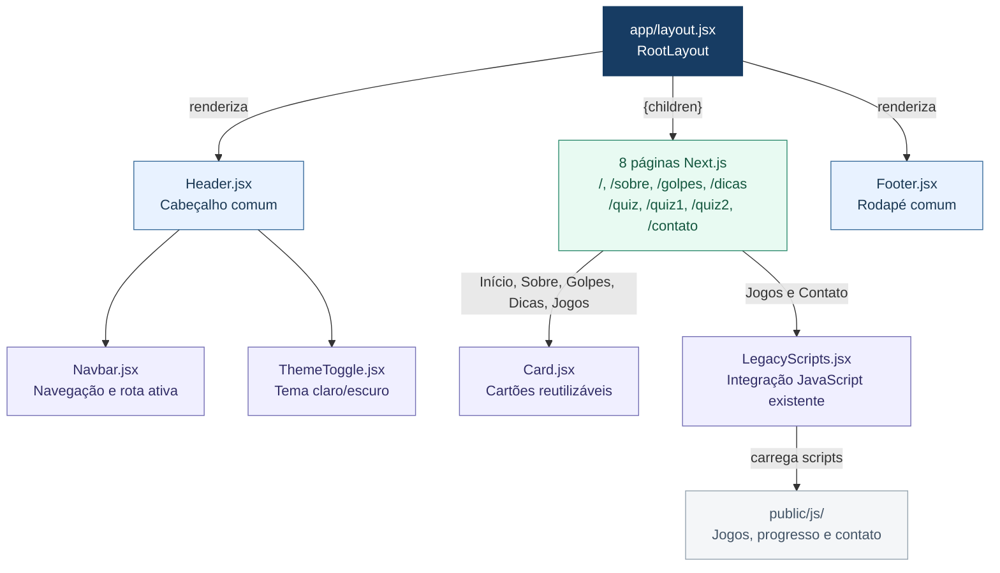

# FraudShield

Projeto educacional de prevenção a golpes digitais, voltado principalmente a pessoas idosas.

## Versões

- **[Projeto 1](Projeto%201/README.md)** — versão original em HTML, CSS e JavaScript, mantida sem alterações.
- **[Projeto 2](Projeto%202/README.md)** — migração para React/Next.js com componentes de interface reutilizáveis e oito páginas.

## Diagrama dos componentes — Projeto 2

O diagrama abaixo mostra **quais componentes renderizam ou utilizam outros componentes** na aplicação Next.js. As setas representam essas relações, conforme os arquivos reais da pasta `Projeto 2/`.



**Como ler:** `app/layout.jsx` renderiza `Header`, o conteúdo da rota (`children`) e `Footer`. `Header` utiliza `Navbar` e `ThemeToggle`. As páginas Início, Sobre, Golpes, Dicas e Jogos reutilizam `Card`. As rotas Jogos e Contato utilizam `LegacyScripts` para carregar os scripts originais de `public/js/`.

**Código-fonte:** [componentes React](Projeto%202/components/) · [layout do Next.js](Projeto%202/app/layout.jsx) · [diagrama editável](Projeto%202/docs/diagrama-componentes.mmd).

## Rodar o Projeto 2

Pré-requisito: Node.js 20.9 ou superior.

```bash
cd "Projeto 2"
npm install
npm run dev
```

Acesse http://localhost:3000. Veja o tutorial e a declaração de uso de IA no README do Projeto 2.
